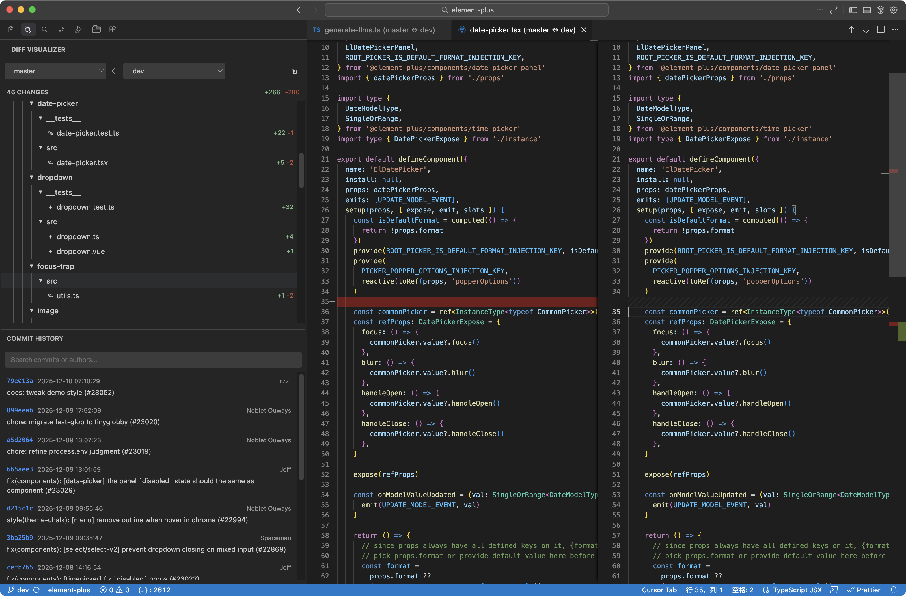

# Diff Visualizer

A VSCode/Cursor extension to visualize file changes and commit history between Git branches.

## Background

In Cursor 1.7 and earlier versions, there was a built-in feature to compare branches and view all file changes. However, this feature was removed in later versions. This extension was developed to bring back that functionality.

## Features

- **Branch Comparison**: Select two branches and instantly see all file changes
- **File Tree View**: Display changed files in a directory structure with expand/collapse support
- **Commit History**: List all commits between the two branches, with a search box to filter by message, author or short hash
- **Quick Diff**: Click any file to open VSCode's built-in diff view
- **Open in Editor**: Click the pencil icon on a file to open the working copy directly
- **Working Tree Support**: When the target branch is the currently checked-out branch, uncommitted changes are included and marked with `· 含未提交`
- **Auto Refresh**: Watches `.git` and the built-in Git extension, so switching branches or editing files updates the panel automatically
- **Follow Current Branch**: When you switch branches, the target branch follows the new current branch — unless you picked the target manually, in which case only the data refreshes
- **Active File Highlight**: The file open in the editor is highlighted in the tree
- **Resizable Layout**: Drag the divider to balance the changes list and commit history

## Usage

1. Click the **Diff Visualizer** icon in the sidebar
2. Select the base branch and target branch
3. Browse the file changes list and commit history
4. Click a file to view detailed differences

The command **Diff Visualizer: Compare Branches** opens the same view in an editor tab.

## Notes

- Auto refresh relies on the built-in `vscode.git` extension, so it must be enabled
- Switching branches updates the target branch only when it previously pointed at the old current branch; a manually selected target is left untouched
- The panel state (selected branches, expanded folders) is preserved across reloads via webview state

## Development

```bash
npm install
npm run compile   # tsc -> out/
npm run watch     # incremental build
npm run package   # build .vsix via vsce
```

Package with a version bump when reinstalling over an existing build:

```bash
npm version patch --no-git-tag-version
npm run compile
npx @vscode/vsce package
cursor --install-extension ./diff-visualizer-<version>.vsix --force
```

Reload the window after installing for the new build to take effect.

## Screenshot



## Changelog

### 0.0.10

- Target branch now follows the current branch on branch switch, without overriding a manual selection
- Panel refreshes automatically on branch switch, fetch and file save (`.git` watchers plus the Git extension API) instead of only on open, tab focus or the refresh button
- Uncommitted working tree changes are included when comparing against the checked-out branch, and listed as `· 含未提交` plus a `local` commit entry
- The file currently open in the editor is highlighted in the tree, with its parent folders expanded
- `git-show` diff documents invalidate on repo change, so reopened diffs no longer show stale content

### 0.0.9

- Improved commit message formatting

### 0.0.8

- Open files directly from the diff view
